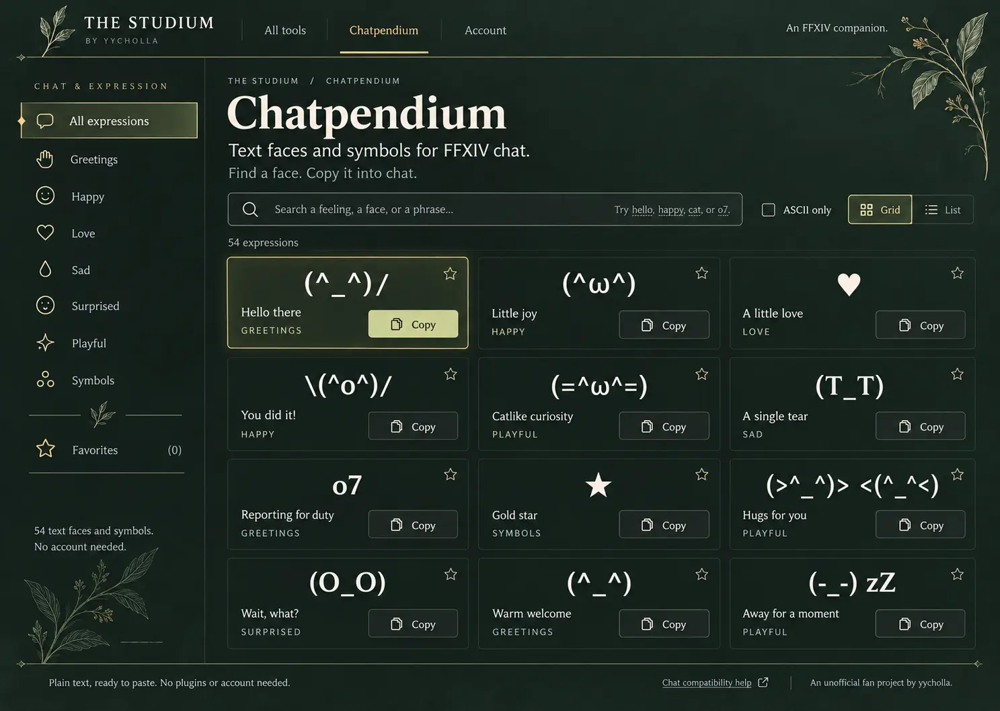

# Studium design baseline

The approved direction is a botanical scholar's archive: a quiet FFXIV companion with the character of an illustrated field journal. The leaf motif is part of the identity, not a generic background flourish. Keep the category sidebar from the archive concept, the clearer copy and iconography from the botanical concept, and offer both grid and list browsing.

## Palette

| Token | Value | Use |
| --- | --- | --- |
| `--bg` | `#132019` | Forest canvas |
| `--panel` | `#17271f` | Catalog cards and account panels |
| `--panel-hover` | `#26362b` | Hovered surfaces |
| `--line` | `#354439` | Quiet boundaries |
| `--text` | `#eee7d8` | Warm paper text |
| `--muted` | `#b5c0b5` | Secondary copy |
| `--gold` | `#dfcc94` | Active navigation and fine accents |
| `--soft-gold` | `#9f946d` | Rules and borders |
| `--sage` | `#c9d39b` | Primary actions and focus |
| `--selected` | `#303c27` | Selected controls |

Use the shared CSS tokens. Primary actions use sage with dark text. The selected expression uses a brass border and moss surface. Status and focus must also have a visible label, outline, or pressed state; color alone is insufficient.

## Type and rhythm

Georgia gives the brand and page titles their bookish character. Source Sans 3 handles controls, captions, body text, and literal expressions. The latter makes raw catalog strings legible without claiming to reproduce the in-game font. Locally served 400 and 600 font files avoid a third-party runtime font dependency. Source Sans 3 is licensed under the SIL Open Font License; see `assets/fonts/OFL.txt`.

The desktop catalog has a 296px sidebar, 32px main gutters, three equal card columns, 12px gaps, and a prominent serif title. Cards have a 4px radius and fine borders. Category captions use small spaced capitals. Keep natural proportions and restrained ornament rather than large pill controls, oversized rounded tiles, gradients, or repeated marketing badges.

Below 1000px the controls wrap and grid uses two columns. Below 760px categories become horizontally scrollable controls above the catalog. Below 560px grid cards use full-width copy buttons, while list rows keep the face/name, favorite, and copy controls within one row grouping. Both views must remain usable at 320px. List view always uses one column regardless of breakpoint.

## Components and behavior

- Shared header: sprig mark, Studium wordmark/byline, three navigation links, thin active underline.
- Sidebar: library icons, a clearly selected category, botanical divider, favorite count, short anonymous-use note.
- Catalog: search, ASCII filter, named Grid/List buttons, result count, expression cards, and Show more.
- Grid: glanceable faces, name and category, favorite and copy actions.
- List: compact single-column rows with the same content and behavior.
- Copy: exact raw catalog string, polite live feedback, and a manual-copy dialog if clipboard access fails. No simulated game-chat preview.
- Preference: `xiv-chatbook:view:v1` stores `grid` or `list`. Favorites retain `xiv-chatbook:favorites:v1`. Both work without storage access and synchronize across tabs.
- Selection: the first visible result is highlighted initially; focusing or copying a card moves the highlight.
- Progressive enhancement: all 54 catalog entries remain selectable in server-rendered HTML without JavaScript.

## Copy

Use concrete labels and short sentences. The anchor copy is “Text faces and symbols for FFXIV chat.” and “Find a face. Copy it into chat.” Prefer familiar expression names such as “Hello there,” “A little love,” and “Reporting for duty.” Avoid abstract productivity promises, feature-count badges, AI terminology, and inflated onboarding text.

Compatibility help must distinguish browser rendering from live-game support. The catalog's source-character constraints continue to apply; the visual baseline does not expand the character allowlist.

## Assets and provenance

The approved reference is stored at `docs/design/selected-reference.webp`, an optimized copy of the user-selected generated concept. Two original transparent botanical images were generated with the built-in Image Gen tool using that exact reference: an upright botanical sprig for the wordmark/divider, and an engraved leafy branch for the upper-right and sidebar margins. Their prompts requested delicate olive leaves, warm sage/brass linework, a transparent background, no lettering, and the same illustrated field-journal treatment as the selected design. They were resized and converted to WebP for the interface; see `assets/botanical/`.

Icons come from Phosphor Icons Core 2.1.1 (Light with a filled favorite state), consolidated into an SVG symbol sprite without changing their paths. See `assets/PHOSPHOR-LICENSE.txt`. Use that library for future interface icons. Decorative leaves are raster assets, not improvised icon drawings.

All fonts, icons, and botanical images are embedded in the Rust application and emitted by the static exporter. Add future assets to both paths and test their content types. Avoid remote runtime dependencies for visual identity.

## Extending the hub

Future tools should reuse the header, typography, surfaces, action styles, and compact footer. Give each tool a plain name and explain its actual use in one sentence. Keep decorative foliage near page margins and away from interactive controls. The home, account, and policy pages inherit this baseline without changing their existing service behavior.

See [rendered QA](../design-qa.md) for implementation captures and intentional functional differences from the concept.
